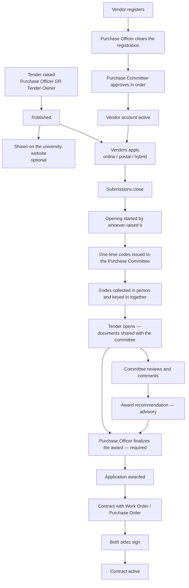
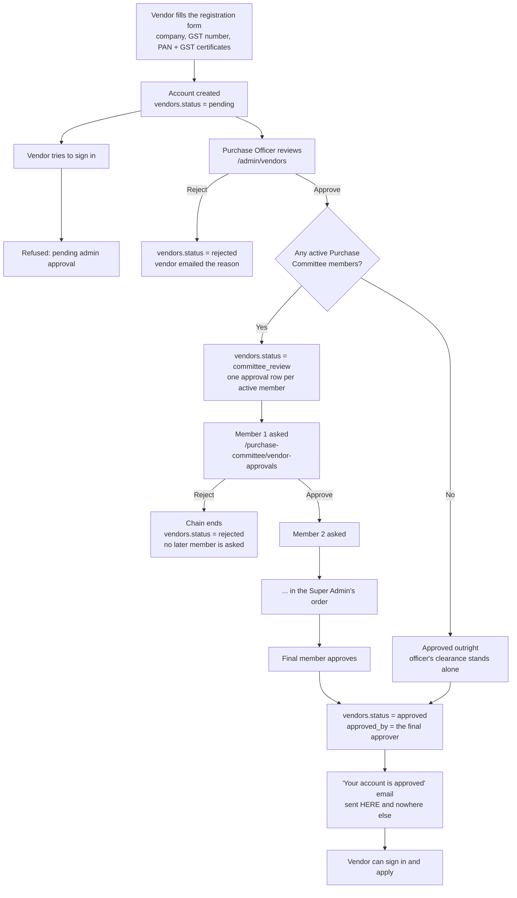
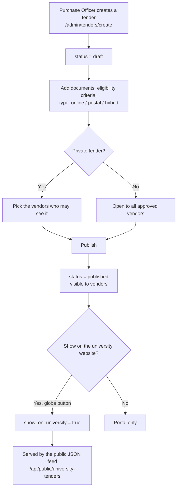
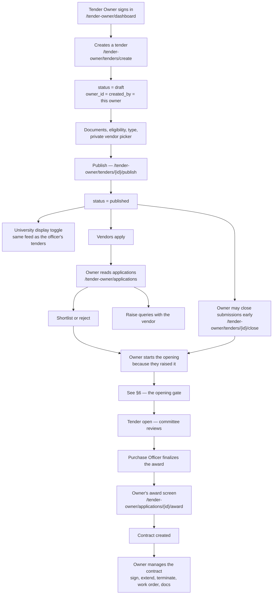
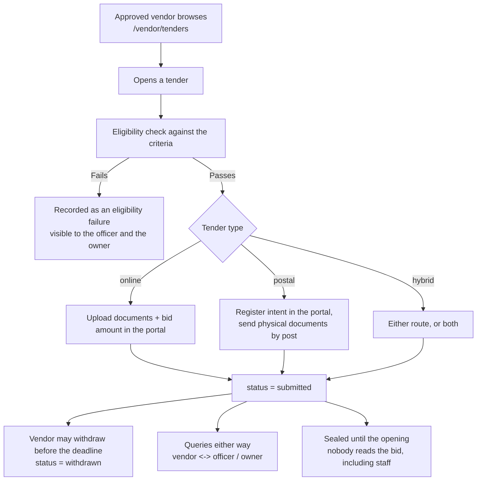
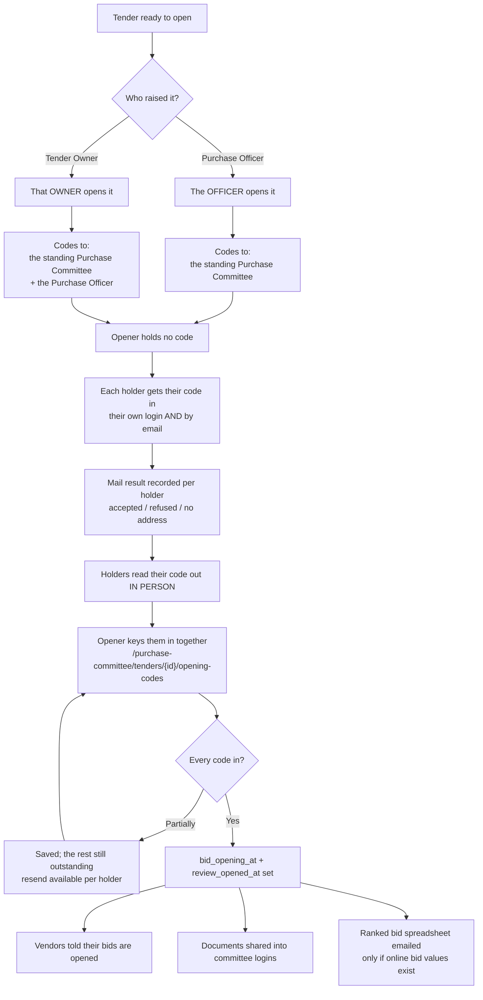
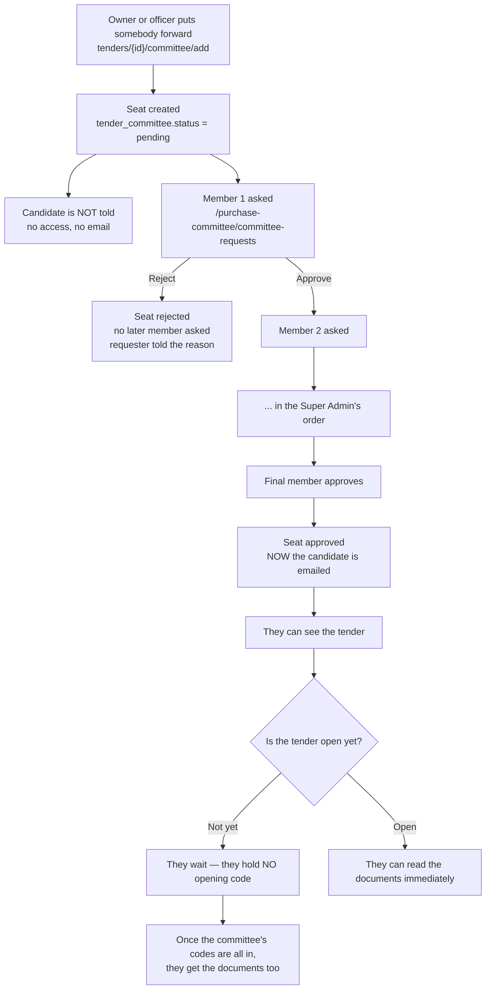
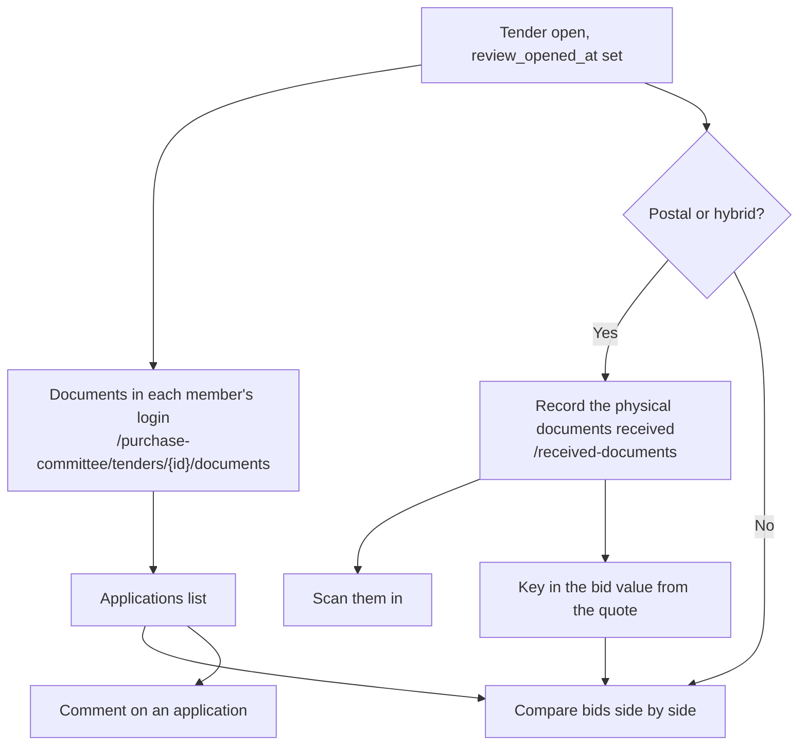
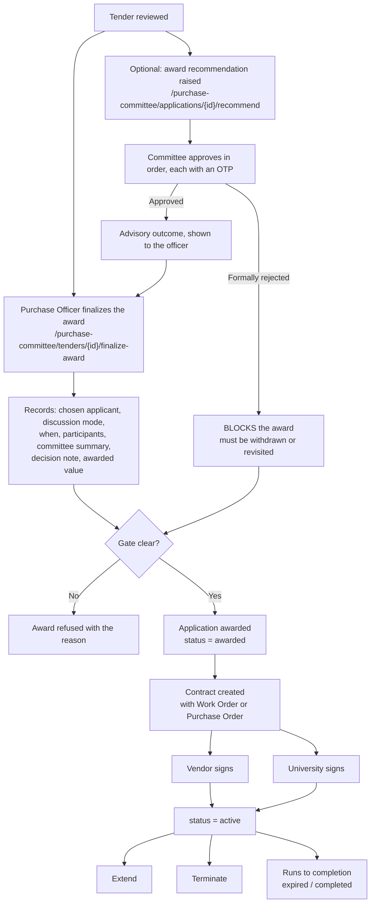
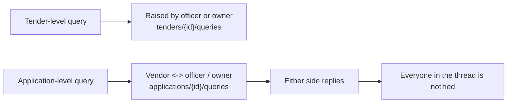

# VMS — Complete Process Flow

**Vendor Management System — VMRF-DU**
Reference as of 20 November 2026. Companion documents: `VMS_User_Roles.md` (who each role is),
`VMS_Complete_Flowchart.pdf` (earlier diagram, July 2026 — superseded by this file).

This describes every path a record can take through the system, from a vendor registering to a
signed contract, including the **Tender Owner's** route end to end. Diagrams are Mermaid, so
they render on GitHub and in most Markdown viewers.

**To print or to reuse the diagrams:**

- `VMS_Complete_Flow_A3.pdf` — **A3 portrait**. Every diagram fits one sheet, whole, at a
  comfortable size. Use this one for the meeting table or the wall.
- `VMS_Complete_Flow_A4.pdf` — **A4 portrait**, for an ordinary desk printer. The tall diagrams
  run over two sheets with an overlap, so no box is ever cut in half.
- `flow/` — each diagram on its own, as **PNG** (drop into Word, PowerPoint or email) and **SVG**
  (scales to any size without blurring).

Both PDFs are fitted automatically: each diagram is measured and scaled to the largest size its
sheet allows, then centred. Print at 100% / Actual size — not "Fit to page".

Both are generated from the Mermaid blocks below, so this file stays the single source: edit a
diagram here and regenerate, rather than editing the images.

A note on vocabulary used throughout:

| Term here | Role in the system | Who that is |
|---|---|---|
| **Purchase Officer** | `admin` | Runs tenders for the whole university |
| **Tender Owner** | `tender-owner` | Raises and runs tenders for their own department |
| **Purchase Committee** | `purchase-committee` | The standing committee, ordered by the Super Admin |
| **Per-tender member** | `committee-member` | Added onto one particular tender only |
| **Vendor** | `vendor` | External supplier |
| **Super Admin** | `super-admin` | Configures the system; can act anywhere |

---

## 1. The whole system at a glance

Three separate **ordered approval chains** run on one list — the standing Purchase Committee,
maintained by the Super Admin at `/super-admin/purchase-committee`:

1. Vendor registrations (§2)
2. Additions to a single tender's committee (§7)
3. Award recommendations (§9)

That one order also decides who holds the **opening codes** (§6). Reordering the list changes
who is asked next; it never rewrites a decision already taken, because each chain copies the
order and designation into its own rows when it starts.

---

## 2. Vendor registration and approval

GST is mandatory: both the number and the certificate. There is one registration shape, not
two.

**Rules enforced in `VendorApprovalChain`, not by hiding buttons:**

- Only the lowest-ordered *pending* step is actionable, so a stale tab or a guessed URL cannot
  jump the queue.
- Any single rejection ends the chain where it stands.
- The officer's own clearance is kept separately on `officer_approved_by`, so `approved_by`
  always names the final approver.
- The officer, the Super Admins and every member who already approved are told the outcome,
  since the officer otherwise hears nothing for however long the committee takes.

**Login messages while waiting** — `pending`: *"Your account is pending admin approval."*
`committee_review`: *"...cleared and is with the Purchase Committee for final approval."*

---

## 3. Raising a tender — Purchase Officer

The university website is **not a page in this system**. It reads the JSON feed and renders the
list itself. The feed returns only tenders that are `published`, flagged `show_on_university`,
and whose submission deadline has not passed.

---

## 4. Raising a tender — Tender Owner

The Tender Owner's path mirrors the officer's, under `/tender-owner`, and differs in two ways:
their screens are **scoped to their own tenders**, and **they open what they raised** (§6).

**What the Tender Owner can do**

| Area | Screen | Notes |
|---|---|---|
| Tenders | `/tender-owner/tenders` | Only tenders they own. Create, edit, publish, close, delete |
| University display | `tenders/{id}/university-display` | Same toggle as the officer |
| **Open a tender** | `tenders/{id}/open-bidding` | Only tenders they raised — see §6 |
| Collect codes | `/purchase-committee/tenders/{id}/opening-codes` | Reached on their own tenders |
| Applications | `/tender-owner/applications` | Shortlist, reject, query, award |
| Per-tender committee | `tenders/{id}/committee` | **Requests** a seat — see §7 |
| Contracts | `/tender-owner/contracts` | Sign, extend, terminate, work order, supporting docs |
| Eligibility failures | `/tender-owner/eligibility-failures` | Who was filtered out, and why |
| Reports | `/tender-owner/reports` | Their own tenders and contracts |

**What they cannot do:** approve vendor registrations, finalize an award, open a tender someone
else raised, or view another owner's tender (`ownerShow()` scopes to their own and returns 403
otherwise).

---

## 5. A vendor applies

**The seal matters:** submitted documents and bid values are not readable by the officer, the
owner or the committee until the opening in §6 completes. That is the point of the code gate.

---

## 6. The opening gate — who opens, who holds a code

This is the heart of the system. The person who **starts** an opening never **holds a code**
for it, so no one can open a tender alone.

**Entitlement** is `Tender::mayBeOpenedBy()` on the model, so the owner's screen, the officer's
screen and the JSON endpoint all answer the same question identically:

| Tender raised by | Opens it | Also opens it | Holds codes |
|---|---|---|---|
| Purchase Officer | Officer | Super Admin | Standing committee |
| Tender Owner | That owner | Super Admin | Standing committee **+ officer** |

Super Admin is the documented fallback — somebody has to be able to act when an owner has
left — and deliberately holds **no** code, so a fallback cannot open a tender alone.

**Starting an opening while bids are still arriving also closes submissions**, in the same
action. Reading part of the field while more arrives behind it would break the seal, and it
spares the opener the old two-step of Close then Open. Opening before the advertised date is
allowed, but the confirmation says so first.

**A code is never shown to the opener.** It reaches the holder's notification bell and inbox
only; the opener learns it when the holder reads it out.

### What the mail report tells you

Each holder's row on the collect-codes screen carries what the mail server said:

| Status | Meaning | Conclusive? |
|---|---|---|
| Accepted by the mail server | The relay took it and gave it a queue ID | **No** — see below |
| Refused by the mail server | Rejected during the SMTP conversation | Yes — nothing was sent |
| Send failed | Failed outside the conversation | Yes |
| No email address | Nothing on the account; the code is in their login only | Yes |

**"Accepted" is not "delivered."** A relay can accept an address whose domain resolves but has
no mailbox, then bounce it minutes later out of band. Gmail does exactly this. Whatever the
status, the code is always in the holder's login notifications, which is the reliable path.

---

## 7. Adding a member to one tender's committee

Inviting somebody onto a single tender does not add them. It files a **pending seat** and asks
the standing Purchase Committee, in the Super Admin's order.

**A per-tender member holds no opening code.** The set of people who can open a tender must not
change from tender to tender — that is what a *standing* committee is for. So approving somebody
mid-opening neither delays the opening nor adds a code to collect.

They still **read the documents**, because `Tender::isReviewUnlockedFor()` accepts either a
collected code *or* an approved seat on that tender. Nothing is readable until review is open,
and only code holders can get it there, so the seal is unaffected: the committee that breaks it
is still the standing one.

Also enforced: the candidate is filtered out when the chain is built, so they can never be
asked to approve their own seat.

---

## 8. Committee review

A purely postal tender has no bid amounts at opening time — they are keyed in afterwards from
the physical quotes, which is why the ranked spreadsheet is only emailed when online values
already exist.

---

## 9. Award and contract

Two distinct things, often confused:

- **Award recommendation** — the committee's sequential sign-off, with its own OTP. **Advisory.**
- **Award finalization** — the Purchase Officer's recorded decision. **Required.** No contract
  without it.

**Why the officer's finalization is the gate rather than the committee's chain:** the
committee's view is advisory — a member may support, oppose or simply remark — and the officer
weighs it alongside the bid values and the documents received. What the officer cannot do is
award *without putting the decision on record*. A recorded committee **rejection** is the one
case still treated as blocking, since letting an award through over an explicit rejection would
make that step meaningless.

A finalization can be **revoked**, with a reason, which reopens the decision.

---

## 10. Queries

Two independent threads, both notifying everyone in the thread rather than one side:

---

## 11. Status reference

| Table | Column | Values |
|---|---|---|
| `tenders` | `status` | `draft` → `published` → `closed` |
| `tenders` | `tender_type` | `online`, `postal`, `hybrid` |
| `tender_applications` | `status` | `submitted`, `under_review`, `shortlisted`, `rejected`, `awarded`, `withdrawn` |
| `vendors` | `status` | `pending` → `committee_review` → `approved` / `rejected` |
| `contracts` | `status` | `draft` → `active` → `expired` / `terminated` / `completed` |
| `tender_committee` | `status` | `pending` → `approved` / `rejected` |
| `tender_committee` | `role` | `chairman`, `member`, `observer`, `technical_expert`, `financial_expert` |
| `tender_review_otps` | `holder_role` | `main` (standing committee), `officer` |
| `tender_review_otps` | `mail_status` | `accepted`, `rejected`, `error`, `no-address` |

---

## 12. Where the gates actually live

Every entitlement below is enforced in model or service code, not by hiding a button, so a
guessed URL or a stale tab cannot get past it.

| Gate | Enforced in |
|---|---|
| Who may open a tender | `Tender::mayBeOpenedBy()` |
| Who holds an opening code | `Tender::openingCodeHolders()` |
| Who may read the documents | `Tender::isReviewUnlockedFor()` |
| Whose turn it is — vendors | `VendorApprovalChain::actionableStepFor()` |
| Whose turn it is — tender seats | `TenderCommitteeApprovalChain::actionableStepFor()` |
| Whether an award may proceed | `AwardRecommendation::gateBlocksAward()` |
| Which committee seats count | `Tender::committeeMembers()` — scoped to approved + active |

---

## 13. Known gaps in the flow

Recorded so the diagrams above are not read as more complete than the system is:

- **Vendors cannot raise a tender-level query.** Only application-level queries are open to
  them; tender queries are staff-initiated.
- **`vendors/{id}/suspend`, `vendors/{id}/activate` and `vendors/bulk-action`** are routed to
  controller methods that do not exist, so those buttons fail.
- **Registration validates `unique:users` but not `unique:vendors`.**
- **A dropped approval email is not retried.** If the mail to a vendor fails at the moment of
  final approval, the status is still `approved` and nothing re-sends it.
